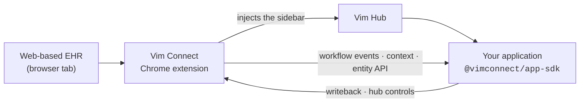

<div align="center">
  <br />
  <a href="https://getvim.com" target="_blank">Vim</a>
    <span>&nbsp;&nbsp;-&nbsp;&nbsp;</span>
  <a href="https://developer-docs.getvim.ai/docs" target="_blank">Developer docs</a>
    <span>&nbsp;&nbsp;-&nbsp;&nbsp;</span>
  <a href="https://github.com/vimconnect/vim-demo-app" target="_blank">Demo app</a>
    <span>&nbsp;&nbsp;-&nbsp;&nbsp;</span>
  <a href="https://developer-docs.getvim.ai/docs/api-reference" target="_blank">API reference</a>
    <span>&nbsp;&nbsp;-&nbsp;&nbsp;</span>
  <a href="https://developer-docs.getvim.ai/docs/developer-account" target="_blank">Get access</a>
    <span>&nbsp;&nbsp;-&nbsp;&nbsp;</span>
  <a href="https://developer-docs.getvim.ai/docs/changelog" target="_blank">Changelog</a>
    <span>&nbsp;&nbsp;-&nbsp;&nbsp;</span>
  <a href="https://getvim.com/blog" target="_blank">Blog</a>
  <br />
  <hr />
</div>

# 👋 Hello Vim developers!

## The Vim Connect developer platform

Vim is the middleware platform for healthcare. **Vim Connect** is Vim's in-EHR connectivity
layer, and the **Vim Connect App SDK** ([`@vimconnect/app-sdk`](https://www.npmjs.com/package/@vimconnect/app-sdk))
lets you build applications that run *inside* Electronic Health Record (EHR) systems. Your app
appears as a sidebar in the provider's EHR — the **Vim Hub** — with real-time access to patient
data, encounters, referrals, and orders, and the ability to write back to the chart.

You build and ship your app end to end yourself: create it in the **Vim Console**, declare what it
needs in its **manifest**, test it against your own **Sandbox EHR**, submit a version for review,
and publish it to the marketplace where practices discover and install it.

## How it works

Vim Connect uses a Chrome extension that injects the Vim Hub into web-based EHRs. Your application
loads inside that hub and talks to the extension through the SDK.



The extension detects EHR context, extracts data from the page, and injects the hub. Everything
your app sees or changes goes through the SDK — no EHR-specific integration work on your side.

## What you can build

* **Clinical decision support** — surface care gaps, drug interactions, or quality measures when a patient chart opens
* **Documentation assistants** — pre-fill encounter notes, assessment fields, or referral details
* **Prior authorization** — automate auth workflows when orders or referrals are created
* **Care coordination** — display care team info, schedule follow-ups, or track referrals
* **Population health** — show risk scores, wellness reminders, or preventive care alerts

## SDK capabilities

| Capability | Description |
| --- | --- |
| **Workflow Events** | Get notified when the provider opens a chart, starts an encounter, creates a referral, or places an order — `chart_open`, `encounter_open`, `referral_start`, `referral_save`, `order_select`, `order_sign` |
| **Context Tracking** | Subscribe to real-time entity data changes as the provider navigates the EHR |
| **Entity API** | Read patient demographics, problems, medications, allergies, lab results, vitals, insurance, and encounter details |
| **Writeback** | Update encounter notes, diagnoses, orders, and referrals — with permission controls for disruptive operations |
| **Hub Controls** | Set your app icon status, show notification badges, display push notifications, and control visibility |
| **Type Safety** | Full TypeScript types and Zod schemas for every entity, event, and API method |

Entities today: `patient`, `encounter`, `order`, `referral`, `providerRecord`. Coverage varies by
EHR — check the [EHR Support Matrix](https://developer-docs.getvim.ai/docs/ehr-support) before you
finalize your manifest.

## Quick start

The [Demo App](https://github.com/vimconnect/vim-demo-app) is a public GitHub template — a complete
Next.js Vim app with the OAuth flow, SDK initialization, and an **SDK Explorer** that drives every
capability your manifest declares against live EHR context.

```bash
gh repo create my-vim-app --template vimconnect/vim-demo-app --private --clone
cd my-vim-app
npm install
npm run dev            # http://localhost:8080
```

You'll need three environment variables — `APP_ENV`, `CLIENT_ID`, and `CLIENT_SECRET` — from an
environment on your app in the Vim Console. See
[Getting your client ID and secret](https://developer-docs.getvim.ai/docs/developer-account#getting-your-client-id-and-secret).

Prefer to start from an empty project? The
[Quick Start](https://developer-docs.getvim.ai/docs/getting-started/quick-start) builds the launch
page, the token exchange, and a single `chart_open` subscription from scratch in about five minutes.

### A minimal app

```typescript
import { initVimSDK } from '@vimconnect/app-sdk';

const sdk = await initVimSDK();
sdk.hub.setActivationStatus('ENABLED');

sdk.ehr.workflow.on('chart_open', (event) => {
  console.log('Chart opened for patient:', event.entities.patient.id);
});
```

## Building with an AI coding agent

`@vimconnect/app-sdk` ships a Claude Code skill, **`vim-app-sdk-docs`**, that makes your agent look
up real entity fields, event ids, and method signatures instead of inventing them. One `cp` to
install:

```bash
cp -r node_modules/@vimconnect/app-sdk/skills/vim-app-sdk-docs .claude/skills/vim-app-sdk-docs
```

The docs are also published for machines: [`llms-full.txt`](https://developer-docs.getvim.ai/llms-full.txt)
for the full prose reference and
[`api-reference.json`](https://developer-docs.getvim.ai/collection/api-reference.json) for the
generated entity, event, and method catalog. See
[Build with an AI Agent](https://developer-docs.getvim.ai/docs/getting-started/ai-tooling).

## 🖥️ Repositories in this org

| Repo | What it is |
| --- | --- |
| [vim-demo-app](https://github.com/vimconnect/vim-demo-app) | The reference Vim Connect app — OAuth, SDK init, and the SDK Explorer. Use it as a template. |

More samples are on the way. Building on the previous SDK? Those examples live in the
[getvim](https://github.com/getvim) organization.

## 📚 Documentation

* [Developer docs portal](https://developer-docs.getvim.ai/docs) — SDK reference, guides, and the API reference
* [Authentication](https://developer-docs.getvim.ai/docs/authentication) — the OAuth 2.0 flow, end to end
* [EHR Connectivity](https://developer-docs.getvim.ai/docs/ehr-connectivity) — workflow events, context, entity API, and writeback
* [Managing your developer account](https://developer-docs.getvim.ai/docs/developer-account) — creating an app, the manifest, the Sandbox EHR, review, and going live
* [EHR Support Matrix](https://developer-docs.getvim.ai/docs/ehr-support) — which capabilities exist in which EHR

## Contributing

* **How can I submit an improvement?**

  Improvements are always welcome! 🥳 Open a PR with a clear description and we'll review it as
  soon as possible.

* **Spot a bug 🕷?**

  We welcome changes that improve the samples or fix a problem. Please follow the repo's
  conventions, open an issue describing what you found, and we'll take a look.
